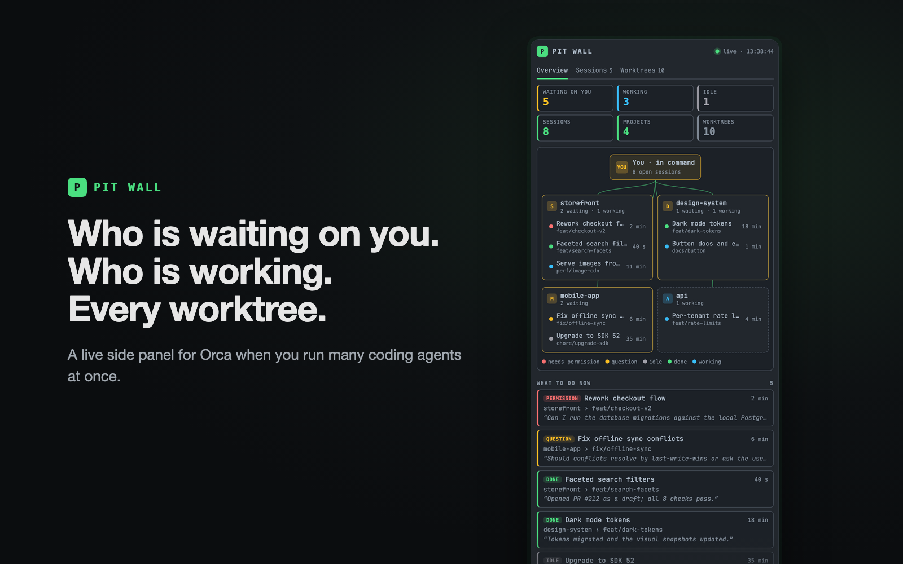
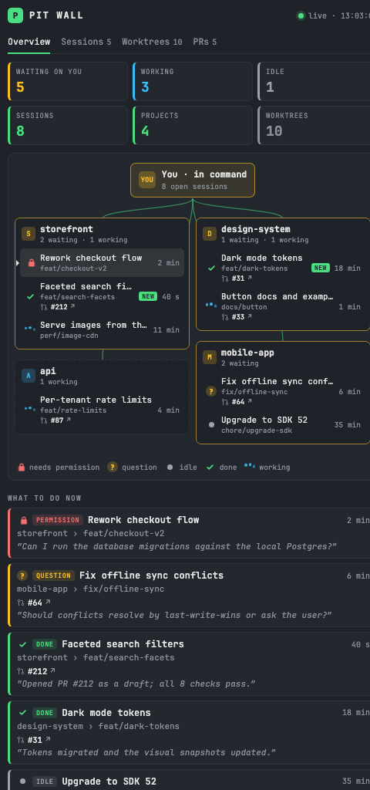

<p align="center">
  <a href="#installation"></a>
  <a href="#installation"></a>
  <a href="#contributing"></a>
  <a href="#license"></a>
</p>

# Pit Wall

**Who is waiting on you. Who is working. Every worktree.**

Run a few coding agents at once and the hard part stops being the code. One
asked a question ten minutes ago, another needs permission, a third finished
and is sitting idle, and you only notice when you go looking.

Pit Wall is a read-only side panel for Orca that answers that at a glance.
It draws every open agent session as an org chart (you → projects →
sessions), each state with its own icon, and tells you what to do next. Built around
"one task = one worktree = one session".

Let's get back to work 🙂

<p align="center">
  <a href="#features">🌟 Features</a> ·
  <a href="#installation">📲 Installation</a> ·
  <a href="#usage">🐒 Usage</a> ·
  <a href="#how-it-works">🔍 How it works</a> ·
  <a href="#permissions">🔒 Permissions</a> ·
  <a href="#contributing">❤️ Contributing</a>
</p>

<p align="center">
  
</p>

<a name="features"></a>

## 🌟 Features

- 🚦 **See every session's state:** permission, question, idle, done or working, each with its own icon and color. Only what needs you moves.
- 🗺 **Org chart:** you → projects → open sessions, with the projects that need you first.
- 🎯 **What to do now:** the sessions that have waited on you the longest, with their last message.
- 👀 **Put seen sessions aside:** finished ones you already opened stop counting as pending, until the agent moves again.
- 😴 **Catch stuck agents:** sessions Orca still calls "working" but that were cut off show up as idle, waiting on you.
- 🌳 **Every worktree, by project:** branch, PR state, checks and how many agents wait or work there.
- 🔀 **PRs that need you:** failing checks first, then running, ready for review and drafts.
- ⚡️ **Live:** refreshes every 5 s and instantly when an agent changes state.
- 🎨 **Native look:** uses Orca's theme, light and dark.

<a name="installation"></a>

## 📲 Installation

Needs **Orca 1.4.259** or later.

```sh
orca plugin install Juanpe/orca-pit-wall
```

Orca shows what the plugin can do and asks you to re-run the command with
`--approve <fingerprint>`. [What it asks for and why →](#permissions)

Then open the panel:

```sh
orca plugin open juanpe.pit-wall --panel pit-wall
```

Releases follow [Semantic Versioning](https://semver.org/spec/v2.0.0.html);
Orca installs the newest `vX.Y.Z` tag. Update with `orca plugin update juanpe.pit-wall`.

<a name="usage"></a>

## 🐒 Usage

There are four tabs:

| Tab | What you get |
| --- | --- |
| 🗺 **Overview** | Six counters, the org chart and **What to do now** |
| 💬 **Sessions** | Everything waiting on you, everything working and, collapsed, the ones you already saw |
| 🌳 **Worktrees** | Every worktree grouped by project, most recent first, with branch, PR (`draft`, `open`, `merged`) and checks |
| 🔀 **PRs** | Every PR in your worktrees by what it needs: checks failing, checks running, ready for review, drafts and, collapsed, merged or closed |

Each session's state reads from its icon:

| Icon | State |
| --- | --- |
| 🔒 shakes | Needs permission |
| **?** tilts | Asked a question |
| ● still | Idle at the prompt |
| ✓ + `NEW` | Done, until you open it |
| ••• bounce | Working |

With *Reduce motion* turned on in macOS, nothing moves.

- **Click a session** → focuses its terminal.
- **Click a session's `#123`** → opens its PR on GitHub. Only sessions whose
  worktree has a PR show it.
- **Click a worktree or a PR** → opens the worktree.
- **The worktree open in Orca** is marked with ▸ and a light fill, in the org
  chart and in Worktrees.
- **The header** says `● live · time`, and switches to `no data` if refreshing stops.

> 💡 Questions and permission prompts are never put aside as seen: they wait
> until you answer them.

<a name="how-it-works"></a>

## 🔍 How it works

- The plugin API (`workspace.list` with status and `agents.list` per
  workspace) is the source of truth: which worktrees and agents exist, and
  their state.
- What the API doesn't provide (PR and checks, session title, last message,
  tool in progress) the worker adds by running `orca worktree ps --json`
  (read-only, cached for 4 s). If that fails, the panel keeps working and
  warns that those details are missing.
- Agents without an open terminal (closed sessions) are left out.
- **Idle:** the API sometimes still says "working" after a session was cut
  off without telling Orca (Esc, Ctrl-C, a half-finished exit). If
  `orca worktree ps` doesn't see that agent working, Pit Wall shows it as
  idle and waiting on you, which is where it really is.

<a name="permissions"></a>

## 🔒 Permissions

| Access | Why |
| --- | --- |
| `trusted-worker` | Its own Node process, to read Orca and run `orca worktree ps` |
| `workspace:read` | List your worktrees and the agents in them |
| `agent:read` | Refresh the moment an agent changes state |
| `workspace:write` | Only `terminal.focus` and `workspace.open`, when you click |
| `storage:own` | Only the list of sessions you already saw, in the plugin's own folder |

Pit Wall changes nothing in Orca. Disable it with
`orca plugin disable juanpe.pit-wall`, or remove it with
`orca plugin uninstall juanpe.pit-wall`, which also deletes its folder.

<a name="contributing"></a>

## ❤️ Contributing

Found a bug? Want another view? I'd love to hear about it.

- [Open an issue](https://github.com/Juanpe/orca-pit-wall/issues) with a screenshot.
- Suggest an improvement or send a pull request.

To work on it, load this folder as a development plugin:

```sh
orca plugin dev watch . --check --shot .orca/shots   # load and reload on save
orca plugin test . --json                             # src/*.test.ts
orca plugin shot local.pit-wall --width 320 --json    # screenshot of the panel
orca plugin dev request . snapshot --json             # what the worker sends the panel
npx -p typescript tsc -p .                            # types (after `orca plugin types .`)
```

| File | What it does |
| --- | --- |
| `src/model.ts` | Joins API and CLI data and sorts the sections (pure, tested in `model.test.ts`) |
| `src/view.ts` | Groups by project, separates new from seen and sorts PRs (pure, tested in `view.test.ts`) |
| `src/worker.ts` | Reads Orca and answers `snapshot` and `open` |
| `panel/index.html`, `panel/app.ts` | The panel: HTML, CSS and the SVG org chart |

When you're done, `orca plugin dev unload .` removes the development copy.

## 👨🏻‍💻 Author

Made by [Juanpe Catalán](https://github.com/Juanpe).

<a name="license"></a>

## 👮🏻 License

Pit Wall is available under the [MIT license](LICENSE).
